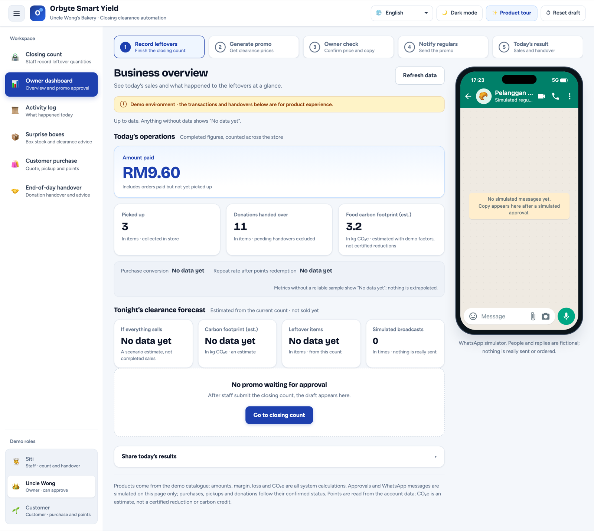
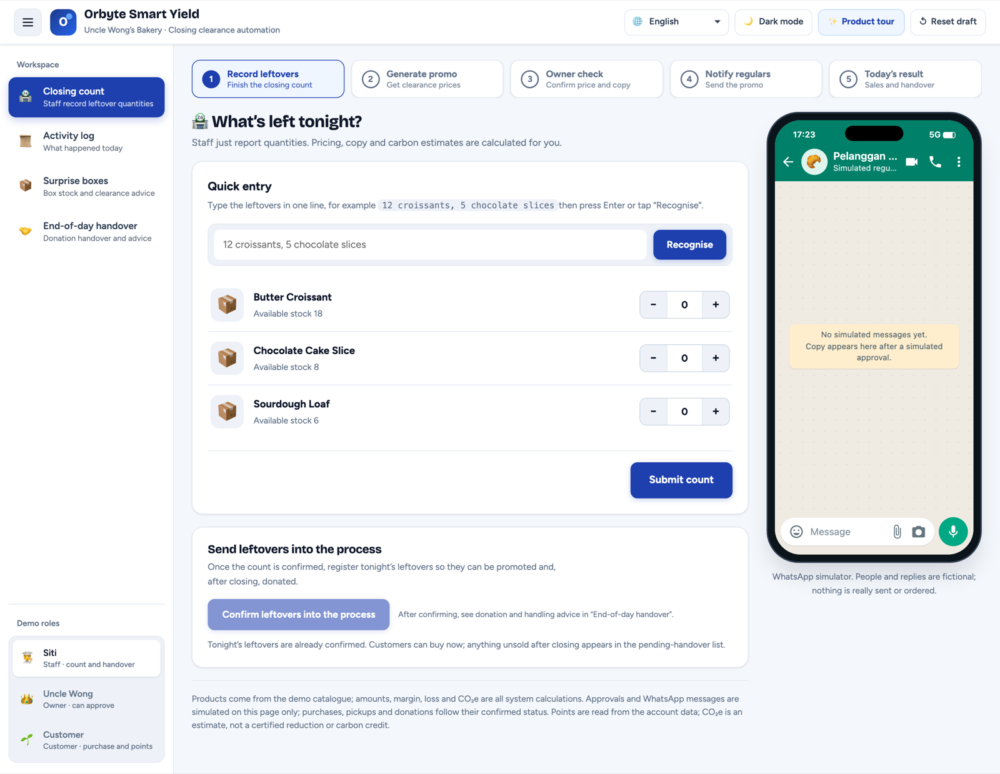
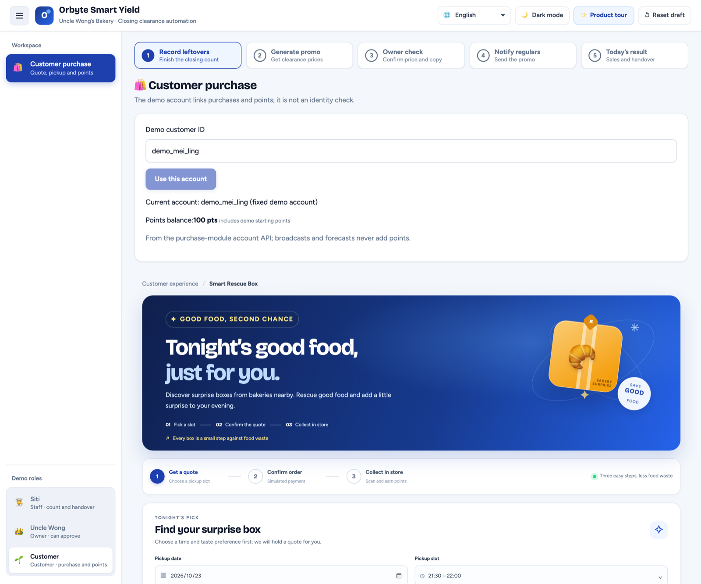
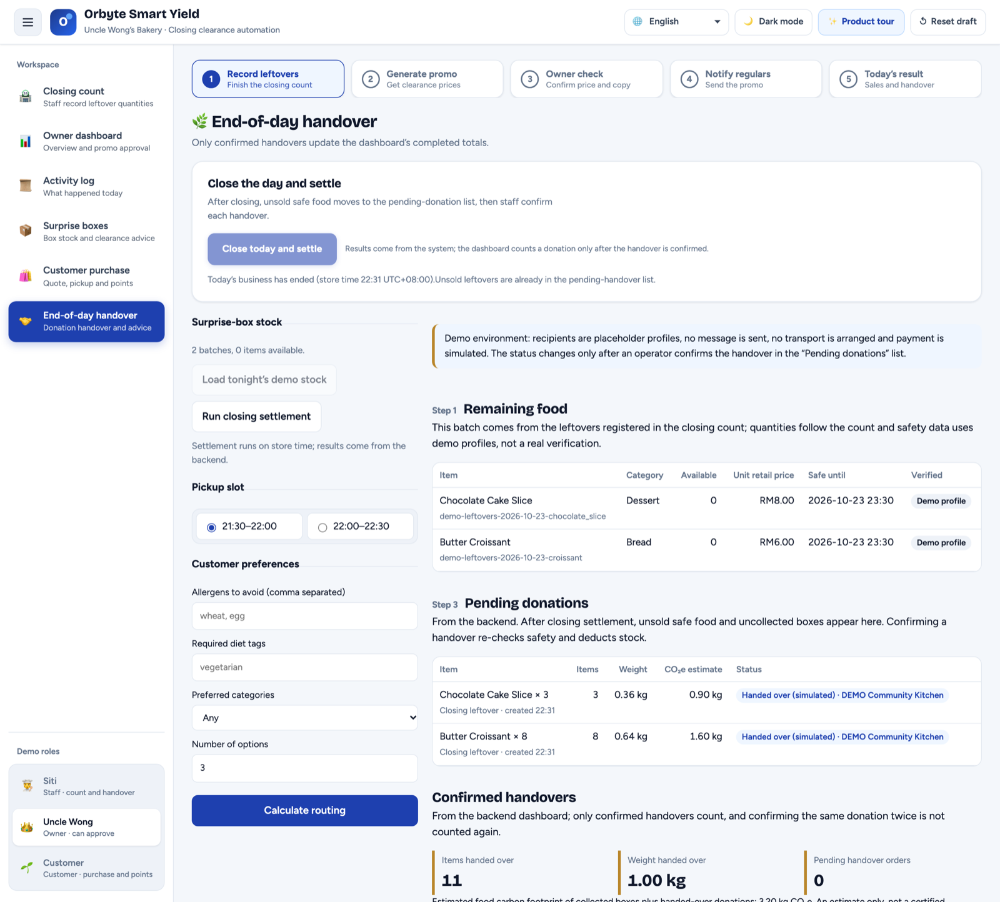
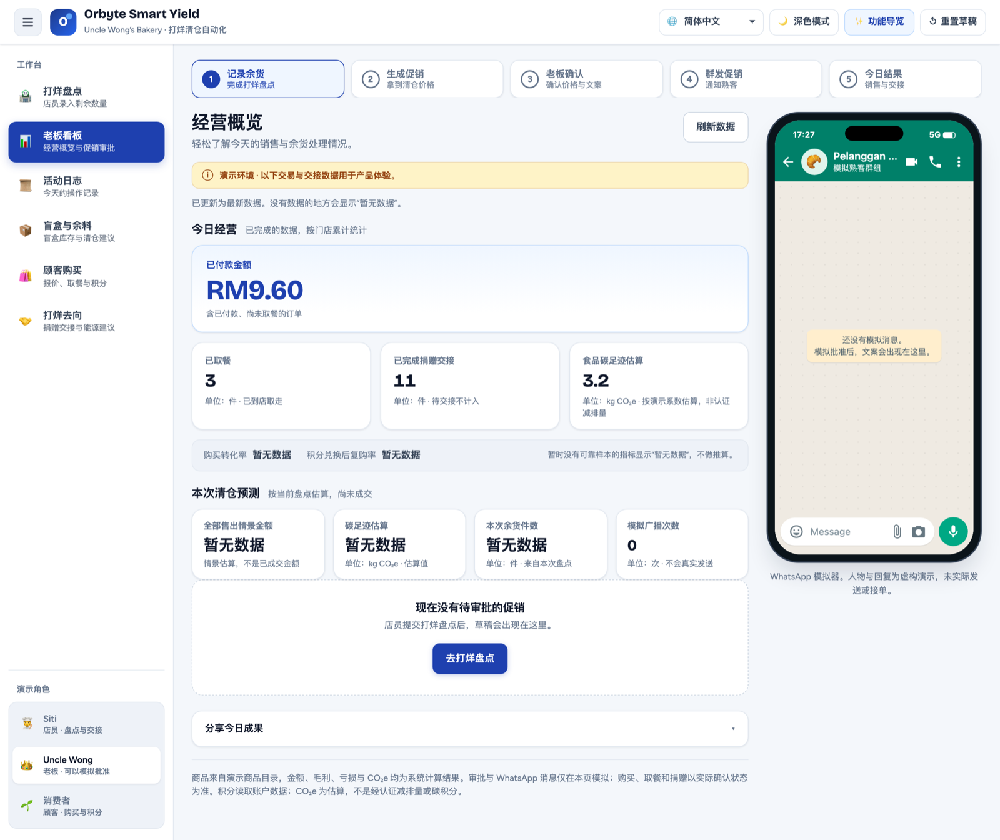
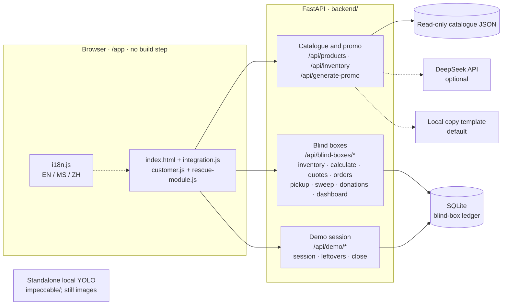

<div align="center">

<h1>NexFlow</h1>

**Closing-time automation for small bakeries — one workspace for surplus stocktaking, clearance decisions, customer pickup and food-rescue records.**

[](#requirements)
[](#technology-stack)
[](#technology-stack)
[](#technology-stack)
[](#key-features)
[](#demo-scope--limitations)
[](LICENSE)

[SDC Domain 2](#sdc-hackathon-2026--domain-2) · [Why NexFlow](#why-nexflow) · [Features](#key-features) · [Local YOLO demo](#local-yolo-image-demo) · [Screenshots](#screenshots) · [Quick start](#quick-start) · [Walkthrough](#demo-walkthrough) · [Architecture](#architecture) · [Testing](#testing) · [中文快速开始](#中文快速开始)

</div>

> NexFlow is the project name. The store-facing web app served by this repository is branded **Orbyte Smart Yield** (v1.2.2) — same code base, same demo.

## SDC Hackathon 2026 — Domain 2

| Submission item | Details |
|---|---|
| Team | Nexgen |
| Project | NexFlow / Orbyte Smart Yield |
| University / registered leader / member count | TODO — HUMAN VERIFICATION: confirm registered team details; do not infer from Git handles |
| Deployment address | https://orbyte-smart-yield-nexgen.replit.app/ |
| Domain | **Domain 2 — Orbyte Smart SME Challenge** |
| Main SDG | **SDG 8**, especially Targets 8.2 (productivity through technology) and 8.3 (MSME growth) |
| Related SDGs | SDG 12 (Responsible Consumption and Production), related to the food-surplus use case. |
| GitHub repository | [Nexgen-XMUM/Nexflow](https://github.com/Nexgen-XMUM/Nexflow) |
| Live Demo | [Public Replit deployment](https://orbyte-smart-yield-nexgen.replit.app/) · [Local workspace](#4-open-the-app) · [Standalone local YOLO](#local-yolo-image-demo) |
| Demo video | TODO — HUMAN VERIFICATION: add the final public video link and confirm organizer duration |
| Slide deck / PRD | TODO — HUMAN VERIFICATION: add final share links |
| Replit proof | [Public-access evidence PDF](submission/SDC2026_Nexgen_Replit_POU.pdf); owner deployment screenshot still needed |
| Technical declaration | [Official form filled as unsigned draft](submission/SDC2026_Nexgen_TechDeclaration.pdf) |
| RunPod | Not used. No endpoint or proof-of-use PDF; team accepts the template-compliance risk. |

The Domain 2 challenge asks for an easy-to-learn automation product that removes a recurring SME burden and demonstrates a complete journey: **trigger → connected data → decision → human approval → visible, recorded outcome**. NexFlow targets the end-of-day bakery surplus workflow.

### Domain 2 fit and current scope

| Challenge expectation | NexFlow response and current status |
|---|---|
| One meaningful SME problem | Bakery staff manually count and route unsold products at closing; details can be fragmented across paper and messages. |
| Core automated journey | The main app demonstrates the closing workflow with demo inventory and simulated business actions. The separate local YOLO app runs inference on a single still image; these two paths are **not yet connected end-to-end**. |
| Accuracy and ease of learning | The local detector suggests counts; staff can review and correct them before confirming. Measure count corrections and stocktake time in a future pilot; no measured field results are claimed. |
| People stay in control | Count confirmation is manual; the owner reviews the promotion draft. Demo identities and external actions are simulated, not production permissions or integrations. |
| Orbyte fit and reuse | The product is framed as a reusable SME workflow that could connect stock, promotions, pickup and food-rescue services through a shared business hub. This prototype does not connect to Orbyte's live platform. |
| Business benefit and SDG | Intended benefits are fewer manual steps and a more consistent closing record. The project aligns primarily with SDG 8; food-waste reduction can support SDG 12. Benefits are expected, not yet measured. |

**CCTV roadmap, not a current feature:** continuous camera monitoring, tracking likely customer removals across video frames, and automatically syncing changed quantities to NexFlow inventory are not implemented. The local detector currently analyzes uploaded still images, then saves a staff-confirmed record on the local machine.

> **Competition data rule:** The Domain 2 materials say to use team-created synthetic data and not real customer or company records. The repository's YOLO materials attribute the model/sample data to the Roboflow Universe `breaddetector/bread-detector` dataset (CC BY 4.0). Declare the model and dataset in the Technical & Tools Declaration and confirm with the organizers whether this third-party training/test material is permitted. For a judged demo, use team-created synthetic test images unless the organizers approve otherwise; do not present a random Google image as synthetic data.




---

## Table of contents

- [SDC Hackathon 2026 — Domain 2](#sdc-hackathon-2026--domain-2)
- [Local YOLO image demo](#local-yolo-image-demo)
- [Why NexFlow](#why-nexflow)
- [Key features](#key-features)
- [Screenshots](#screenshots)
- [Quick start](#quick-start)
  - [Requirements](#requirements) · [Clone](#1-clone-the-repository) · [Windows](#2-windows-powershell) · [macOS / Linux](#3-macos--linux) · [Open the app](#4-open-the-app) · [Demo runtime notes](#demo-runtime-notes) · [Troubleshooting](#troubleshooting)
- [Demo walkthrough](#demo-walkthrough)
- [Architecture](#architecture)
- [Technology stack](#technology-stack)
- [Project structure](#project-structure)
- [Testing](#testing)
- [Configuration](#configuration)
- [API overview](#api-overview)
- [Demo scope & limitations](#demo-scope--limitations)
- [Team](#team)
- [License](#license)
- [中文快速开始](#中文快速开始)

---

## Why NexFlow

Independent bakeries close with unsold bread every night. The work that follows is repetitive and fragmented:

- **Counting** leftovers is done on paper or from memory, after a long shift.
- **Clearance pricing** and a WhatsApp promo are written by hand, and the owner still has to approve the wording before it goes out.
- **What happens to unsold food** — discount, surprise box, donation, waste — is decided ad hoc, with no record of the outcome.
- **Inventory and results** live in different places, so nobody can tell what tonight's leftovers actually earned or saved.

NexFlow puts the whole closing routine in one workspace: staff enter leftover quantities once, the backend prices them and estimates their carbon footprint, promotional copy is drafted, the owner approves it, and whatever is still unsold flows into surprise-box offers, customer pickup and a registered donation handover — with a dashboard that reports only what was actually paid, picked up and handed over.

It is scoped as a **local, demo-grade product for a single store**, not a production SaaS.

## Key features

| Feature | What it does | Status |
|---|---|---|
| **End-of-day stock entry** | Staff type leftovers in one line (`12 croissants, 5 chocolate slices`) or use +/− steppers; quantities are validated against catalogue stock | ✅ Implemented |
| **Smart clearance pricing** | Clearance price = retail × 50%, computed server-side, with below-cost warnings and totals | ✅ Implemented |
| **Carbon footprint estimate** | CO₂e = item weight × per-product factor, shown per draft and in the report | 📐 Estimate — not a certified reduction or carbon credit |
| **AI-assisted promo copy** | WhatsApp-style copy from DeepSeek when configured, with a local template fallback | ✅ Implemented · 🧪 local template by default |
| **Owner approval** | Only the owner persona can approve or reject the draft before anything is "sent" | ✅ Implemented |
| **WhatsApp message simulation** | Animated send / delivered / read states and fictional regulars' replies | 🧪 Simulated — nothing leaves the browser |
| **Surprise (blind) box offers** | Backend search over eligible batches: 2–4 items, at least one staple, sale price ≤ 70% of retail; ranked options or a "no feasible box" reason | ✅ Implemented |
| **Customer quote & simulated checkout** | Quote → payment dialog → reserved order; amounts and points are decided by the backend, retries are idempotent | 🧪 Payment is simulated — no payment provider |
| **Pickup confirmation** | Customer or staff confirms pickup; only then do quantities count as completed | ✅ Implemented |
| **Loyalty points** | 100 points = RM1, up to 30% of one quote; surprise boxes may award points at pickup | ✅ Implemented |
| **Food rescue / donation handover** | After closing, unsold safe food becomes a pending donation; an operator confirms each handover | 🧪 Local demo handover — recipients are placeholder profiles |
| **Business dashboard** | Paid amount, items picked up, items donated, footprint estimate — and "no data yet" instead of invented metrics | ✅ Implemented |
| **Language switching** | English · Bahasa Melayu · 简体中文 from one dropdown, remembered per browser | ✅ Implemented |
| **Light / dark theme** | Shell-only preference, persisted per browser | ✅ Implemented |
| **Bread Count welcome-page showcase** | Fixed front-end replay with pre-generated boxes and counts; uploading an image only previews it | 🎞️ Animation only — no inference on this page |
| **Standalone local YOLO image counter** | `impeccable/` runs the model on an uploaded still image or bundled sample; staff can adjust and confirm counts, saved as local JSON | ✅ Real local image inference; **not synced to main inventory** |

### Honest status of the "smart" parts

- WhatsApp **never sends a real message**; the chat panel is an in-page animation.
- Payments are **simulated**; there is no gateway, card data or settlement.
- Donations are a **local handover record**. Recipient profiles are demo placeholders and no institution is contacted.
- CO₂e values are **estimates** from fixed factors, not verified avoided emissions.
- The DeepSeek copy path is optional; the default demo runs fully offline with the local template.
- The main welcome-page Bread Count experience is a **fixed animation/replay**; its displayed detections are pre-generated and it does not run YOLO inference.
- Real still-image inference runs only in the separate local app at `impeccable/`. Staff can correct and confirm model counts; confirmations are stored as JSON on that computer and are not synced to NexFlow's main inventory.
- **Live CCTV/video detection, tracking likely removals, automatic inventory updates, and backend synchronization are not implemented.**

## Screenshots

Captured during a local simulated demo session: count → leftover registration → customer purchase and pickup → closing → donation handover. The interactions shown are demo flows, not live external transactions.

<table>
<tr>
<td width="50%"><br><sub><b>Staff · Closing count</b> — one-line entry, clearance draft, and the leftovers card.</sub></td>
<td width="50%"><br><sub><b>Customer · Purchase</b> — pickup slot, quote form, loyalty account and orders.</sub></td>
</tr>
<tr>
<td width="50%"><br><sub><b>End-of-day handover</b> — remaining food, pending donations, confirmed handovers.</sub></td>
<td width="50%"><br><sub><b>Owner · Dashboard (简体中文)</b> — same day, same numbers, switched language.</sub></td>
</tr>
</table>

## Quick start

### Requirements

| Requirement | Details |
|---|---|
| **Python 3.10+** | `requirements.txt` pins FastAPI 0.156.4 and Pydantic 2.14.1, which require Python ≥ 3.10. This repo is verified on **Python 3.13**. |
| **Git** | To clone the repository. |
| **Node.js (tests only)** | The web app needs no Node.js and no build step. `node --test` is only used for frontend tests (verified on Node 24). |
| **DeepSeek API key** | **Not needed.** The demo launcher forces the local copy template. |
| **Network** | Not required to run. The page links Google Fonts for typography and falls back to system fonts offline. |

### 1. Clone the repository

```bash
git clone --branch submission https://github.com/Nexgen-XMUM/Nexflow.git
cd Nexflow
```


### 2. Windows (PowerShell)

Run from the repository root:

```powershell
py -3.13 -m venv .venv
.\.venv\Scripts\python.exe -m pip install -r requirements.txt
.\.venv\Scripts\python.exe -m backend.desktop_demo
```

- If `py` is unavailable, use `python`; confirm with `python --version` that it is 3.10 or newer.
- If `.\.venv\Scripts\python.exe` is not found, the virtual environment was not created — re-run the first line.

### 3. macOS / Linux

```bash
python3.13 -m venv .venv      # or: python3 -m venv .venv   (must be 3.10+)
source .venv/bin/activate
python -m pip install -r requirements.txt
python -m backend.desktop_demo
```

Expected first lines:

```text
Competition demo: http://127.0.0.1:8000/app
Local copy; temporary database; application clock starts at 21:35 UTC+08:00.
```

### 4. Open the app

| URL | What it is |
|---|---|
| <http://127.0.0.1:8000/app> | Main workspace (opens as the owner persona) |
| <http://127.0.0.1:8000/app#staff> | Staff window — closing count, activity log, surprise boxes, handover |
| <http://127.0.0.1:8000/app#boss> | Owner window — dashboard, promo approval, every page |
| <http://127.0.0.1:8000/app#customer> | Customer window — quote, simulated payment, pickup, points |
| <http://127.0.0.1:8000/app#rescue> | End-of-day handover (also reachable as `/app/rescue`) |
| <http://127.0.0.1:8000/docs> | OpenAPI docs; demo endpoints under *Competition demo only*, blind boxes under *Blind boxes LOCAL DEMO* |

The three role entries are **demo personas in the browser**, not accounts, logins or permissions — the URL only selects which tab set is visible. There is no authentication anywhere in this build.

Use another port with `python -m backend.desktop_demo --port 8080`.

### Local YOLO image demo (separate service)

The main welcome page's Bread Count display is an animation. To run actual YOLO inference, start the standalone app in `impeccable/`. It analyzes a **single uploaded image** (or a bundled sample), lets staff review/edit the count, and saves confirmations in `impeccable/confirmed/` as local JSON. It does not process a live CCTV stream or sync counts to the main NexFlow inventory.

**Windows:** from the repository root, run `impeccable\start.bat`. On first launch it creates a virtual environment and installs that app's dependencies; internet access is needed for this initial installation.

**macOS / Linux:**

```bash
cd impeccable
python3 -m venv .venv
source .venv/bin/activate
pip install -r requirements.txt
python app.py
```

Open <http://127.0.0.1:8100>, choose a bundled sample or upload a team-approved test image, review/correct the detected quantities, then confirm. The run record remains on the local machine. The model weights are bundled at `impeccable/weights/best.pt`; dependencies are isolated from the main NexFlow app.

### Demo runtime notes

These details matter more than they look:

1. **Temporary database.** `backend.desktop_demo` creates a throwaway SQLite file in an OS temporary directory and deletes it on exit. Restarting gives you an empty store; orders, donations and points from the previous run are gone.
2. **Separate application clock.** The demo starts at **21:35 (UTC+08:00)**; "Close today and settle" moves it to **22:31**. Your computer clock is never changed. Order windows and the closing sweep use this application clock.
3. **No API key, no paid calls.** The launcher forces `AI_PROVIDER=local_demo`, so promo copy comes from the local template even if a key exists in `backend/.env`.
4. **Demo-only endpoints.** `/api/demo/session`, `/api/demo/leftovers` and `/api/demo/close` exist **only** in the demo launcher. Running the normal service (`uvicorn backend.main:app`) returns 404 for them and uses the real clock.

### Troubleshooting

| Symptom | Cause and fix |
|---|---|
| `python: command not found` / `py` not recognized | Python is not on `PATH`. On Windows install from python.org with "Add Python to PATH", or use `py -3.13`. On macOS/Linux use `python3` or `python3.13`. |
| `.venv\Scripts\python.exe` or `.venv/bin/python` missing | The virtual environment was never created. Re-run the `venv` step from the repository root, then install requirements again. |
| `ModuleNotFoundError: No module named 'fastapi'` | Requirements went into a different interpreter. Install with the environment's own Python: `.venv/bin/python -m pip install -r requirements.txt` (macOS/Linux) or `.\.venv\Scripts\python.exe -m pip install -r requirements.txt` (Windows). |
| `No matching distribution found for fastapi==0.156.4` | The virtual environment was created with Python older than 3.10. Delete `.venv`, recreate it with 3.10+ (3.13 recommended), reinstall. |
| `ModuleNotFoundError: No module named 'backend'` | You are not in the repository root. `cd Nexflow` first — the launcher runs as a module. |
| `[Errno 48] Address already in use` / `only one usage of each socket address` | Port 8000 is taken. Run `python -m backend.desktop_demo --port 8080` and open that port. |
| Browser cannot connect | Check that the terminal still shows the uvicorn banner, use `127.0.0.1`, and make sure the port matches the flag you passed. |
| Page loads unstyled or with system fonts | Assets are served by the same app under `/app/assets/*`. A stale cache or a mismatched port is the usual cause — hard-refresh; fonts fall back gracefully offline. |
| Frontend tests fail with a Python path error | Frontend tests spawn `.venv/bin/python` (`.venv\Scripts\python.exe` on Windows). Create the virtual environment before running them. |

## Demo walkthrough

A full demo takes about three minutes. Follow this order — the steps depend on each other.

| # | Role | Page | What to do |
|---|---|---|---|
| 1 | Staff (Siti) | **Closing count** | Type `10 croissants, 4 chocolate slices` (or use +/−), then **Submit count**. The backend returns prices, CO₂e and promo copy. |
| 2 | Staff | **Closing count** | In the *Send leftovers into the process* card, press **Confirm leftovers into the process**. Tonight's leftovers become sellable/donatable batches. |
| 3 | Owner (Uncle Wong) | **Owner dashboard** | Review the draft and press **Simulate approve & send** (or **Reject**). The WhatsApp panel plays a simulated broadcast. |
| 4 | Customer (Mei Ling) | **Customer purchase** | Pick today's slot, press **Find my box**, then **Confirm simulated payment** (optionally redeem points, up to 30%). |
| 5 | Customer | **Customer purchase → My orders** | Press **Simulate pickup** on the reserved order. |
| 6 | Owner | **End-of-day handover** | Press **Close today and settle** and confirm the dialog. Unsold safe food becomes a pending donation. |
| 7 | Owner or Staff | **End-of-day handover → Pending donations** | Press **Confirm handover**, tick the acknowledgement, choose the demo recipient. |
| 8 | Owner | **Owner dashboard** | **Refresh data**: paid amount, items picked up and items donated now reflect the day. |

Things that will bite you if you skip them:

- ⚠️ **Do step 2 before step 4.** If the customer requests a quote while blind-box stock is still empty, the customer module prepares its own synthetic sample batches; a later "Confirm leftovers" then answers `409` (*demo inventory already registered*) and tonight's real leftovers never enter the flow. Restart the demo server for a clean run.
- **"Close today and settle" is owner-only** and asks for confirmation; cancelling sends no request. After closing, leftover confirmation is refused and ordering stops (the store clock is past 22:30).
- **Staff cannot open the owner dashboard** — each persona sees a different tab set by design.
- The current stocktake draft lives in page memory: reloading clears the draft, while backend orders, donations and points survive.

## Architecture



- The **catalogue** (`data/inventory.json`) is read-only product data: name, prices, weight, CO₂e factor and stock.
- The **blind-box ledger** is a separate SQLite database. The demo explicitly registers submitted catalogue quantities as synthetic batches; customer-first auto-seeding is a different path.
- The **demo session** wraps the same app with a temporary database and a controllable clock.

## Technology stack

| Layer | Choice | Notes |
|---|---|---|
| Backend | **Python + FastAPI** | `backend/main.py` for catalogue and promo; `backend/blind_boxes/` for inventory, quotes, orders, donations, dashboard |
| Validation | **Pydantic 2** | Strict types; blind-box money uses integer *sen* |
| Server | **Uvicorn** | One local process, no reverse proxy |
| Storage | **SQLite** (stdlib `sqlite3`) | `data/local/blind-boxes.sqlite3` for the normal service; a temp file for the demo |
| Frontend | **Vanilla HTML / CSS / JavaScript** | One page (`/app`) plus four JS modules; no framework, no bundler, no `package.json` |
| i18n | **Custom dictionary** (`frontend/i18n.js`) | English, Bahasa Melayu, 简体中文; default English, choice kept in `localStorage` |
| AI copy | **DeepSeek API (optional)** | `AI_PROVIDER=deepseek`; the local template keeps the demo offline-safe |
| Backend tests | **pytest + httpx** | API contracts, demo clock, pricing, blind-box rules, asset wiring |
| Frontend tests | **`node:test` + `vm`** | DOM-level behaviour of the page scripts, no browser needed |
| Computer vision | **Ultralytics YOLO + OpenCV** | Independent `impeccable/` image prototype; browser ONNX experiments in `train_bread/`; not main-inventory integration |

## Project structure

```text
Nexflow/
├── backend/
│   ├── main.py                  # FastAPI app: catalogue, inventory, promo generation
│   ├── ai_copy.py               # DeepSeek call + local template fallback
│   ├── desktop_demo.py          # demo launcher: temp DB + controllable clock
│   ├── blind_boxes/             # batches, quotes, orders, pickup, sweep, donations, dashboard
│   ├── tests/                   # pytest suite
│   └── .env.example             # configuration template
├── frontend/
│   ├── index.html               # the whole workspace (/app)
│   ├── integration.js           # dashboard, roles, closing actions
│   ├── customer.js              # quote, payment dialog, pickup, points
│   ├── rescue-module.js         # handover and donation module
│   ├── i18n.js                  # EN / MS / ZH dictionary
│   ├── *.css
│   └── tests/                   # node:test suites
├── data/
│   ├── inventory.json           # product catalogue (read-only)
│   └── charities.json, customers.json, users.json   # demo placeholders
├── docs/
│   ├── readme-assets/           # screenshots used by this README
│   ├── desktop-integration/     # handover, quickstart, demo script, acceptance notes
│   └── ...                      # audit and integration notes
├── impeccable/                  # standalone FastAPI + YOLO local image-counting demo
├── train_bread/                 # legacy browser/ONNX detector assets
├── deliveries/                  # zipped handoff build (historical)
├── requirements.txt
└── LICENSE
```

Startup entry points: `backend.desktop_demo` (demo, recommended) and `uvicorn backend.main:app` (normal service, real clock, persistent SQLite).

## Testing

```bash
# Backend — no network, no API key required
.venv/bin/python -m pytest backend/tests -q

# Frontend — DOM-level tests (needs Node.js and the same .venv)
node --test frontend/tests/*.test.cjs
```

```powershell
# Windows
.\.venv\Scripts\python.exe -m pytest backend/tests -q
node --test frontend/tests/*.test.cjs
```

What the suites cover:

- **Backend:** catalogue and promo maths (fixed reference example: 10 croissants → RM60 retail, RM20 cost, RM30 clearance, RM10 gross profit, 2 kg CO₂e estimate), validation errors, AI fallback, blind-box eligibility/combination/pricing, quote idempotency, points caps and rollback, pickup and no-show sweep, donation handover idempotency, demo clock isolation, and that `/app` serves the current HTML and assets.
- **Frontend:** rendering of missing values, retry and stale-response handling, the balance provider contract, role windows, closing actions (owner-only, confirmation, duplicate protection), leftovers confirmation guards, i18n coverage, and clipboard fallbacks.

The frontend suite spawns the virtual environment's Python for one integration test, so create `.venv` first. Test counts move as the project evolves — treat any numbers quoted in reviews as a snapshot, not a guarantee.

## Configuration

Copy the template if you need to change behaviour:

```bash
cp backend/.env.example backend/.env         # Windows: Copy-Item backend\.env.example backend\.env
```

| Variable | Default | Purpose |
|---|---|---|
| `AI_PROVIDER` | `local_demo` | `local_demo` makes no external calls; `deepseek` enables paid model calls |
| `DEEPSEEK_API_KEY` | empty | Only used when `AI_PROVIDER=deepseek`. Never commit a real key |
| `DEEPSEEK_MODEL` | `deepseek-flash` | Model name for the copy call |
| `DEEPSEEK_TOTAL_TIMEOUT_SECONDS` | `15` | Whole-request timeout |
| `CORS_ALLOWED_ORIGINS` | empty | Exact browser origins, comma-separated; empty disables cross-origin access |
| `BLIND_BOX_DB_PATH` | `data/local/blind-boxes.sqlite3` | SQLite location for the **normal** service |

Notes:

- The demo launcher deliberately ignores your AI settings: it forces `local_demo` and clears the key.
- `.env` files and the local SQLite database are git-ignored; never commit API keys.
- Zero configuration is the intended default: clone → install → run.

## API overview

| Method | Path | Purpose |
|---|---|---|
| GET | `/api/products` | Product options (id, name, aliases, stock) |
| GET | `/api/inventory` | Retail prices and stock |
| POST | `/api/generate-promo` | Clearance draft for `[{"item":"croissant","qty":10}]` |
| POST | `/api/blind-boxes/calculate` | Ranked boxes, or the reason no box is feasible |
| POST | `/api/blind-boxes/quotes` · `/quotes/confirm` | Quote, then simulated payment → reserved order |
| POST | `/api/blind-boxes/pickup` · `/customer/pickup` | Confirm pickup |
| POST | `/api/blind-boxes/sweep` | Closing sweep: no-shows and unsold stock → pending donations |
| POST | `/api/blind-boxes/donations/handoff` | Confirm a donation handover |
| GET | `/api/blind-boxes/dashboard` | Paid amount, picked up, donated, footprint estimate |
| GET/POST | `/api/demo/session` · `/leftovers` · `/close` | **Demo launcher only** — clock and leftover registration |

Errors use one envelope: `{"error": {"code", "message", "details"}}` — `422` for invalid input, `409` for business conflicts, `503` for missing data, `404` for demo endpoints outside the demo build.

## Demo scope & limitations

**This is a hackathon prototype.** A related public Replit deployment is linked above; the reproducible main workflow and independent YOLO counter can run locally. No production readiness or public YOLO inference endpoint is claimed. The workflows use demo data and do not implement real accounts.

**Implemented end to end:** stocktake entry, clearance pricing, promo drafting with local/AI copy, the owner approval gate, blind-box search and pricing, quote → simulated payment → reserved order → pickup, points earning and redemption caps, the closing sweep, donation handover records, and the dashboard.

**Simulated on purpose:** WhatsApp delivery and replies, payment, donation recipients, and the surprise-box reward are demo mechanics. No external system is contacted.

**Estimates, not measurements:** CO₂e values come from fixed per-product factors; biofuel figures use fixed coefficients. They are not audited reductions or carbon credits.

**Not implemented (and not claimed):** real authentication or roles, real payments, real WhatsApp integration, delivery logistics, multi-store operation, procurement forecasting, and carbon trading.

**YOLO split:** the homepage's Bread Count panel is a visual replay. The separate `impeccable/` app performs local model inference on uploaded still images only; confirmed quantities are stored locally and are not sent to NexFlow's inventory API. It does not monitor CCTV video or automatically detect removals. See [Local YOLO image demo](#local-yolo-image-demo).

**Known issues:**

1. **Customer-before-leftovers ordering.** If a customer requests a quote while blind-box stock is empty, the customer module auto-prepares synthetic sample batches; a later `/api/demo/leftovers` call then returns `409`. Confirm leftovers first (walkthrough step 2), or restart the demo server.
2. **Demo endpoints carry no authorisation.** `/api/demo/*` is a competition helper, not a security boundary; role rules (owner-only closing, staff counts) are UI conventions.
3. **Draft state is not persisted.** Reloading drops the current stocktake draft; backend orders, donations and points survive.
4. **The homepage detector is not live inference.** Use the separate `impeccable/` app for actual still-image model inference; do not rely on the animated showcase to count stock.

## Team

Built at a hackathon by Nexgen (GitHub org `Nexgen-XMUM`). The roles below come from the existing README, not a verified registration record. Registered leader, full roster, institution and contact details: TODO — HUMAN VERIFICATION.

| Role | Member |
|---|---|
| Team lead · integration · frontend | YEO JIN HONG |
| Backend · integration | QIU BO CHUAN |

Additional contributors appear in the commit history under the handles `panpan54847`, `feng-0823` and `navi1021`. Assignments beyond the two roles above are not recorded in this repository, so they are intentionally left out rather than guessed.

## How We Use Replit

The team supplied https://orbyte-smart-yield-nexgen.replit.app/ as its public deployment. On 2026-10-24 the homepage rendered in a browser; `/login`, `/app`, two sampled scripts and read-only demo/inventory APIs returned HTTP 200. `integration.js` matches the checked-out main baseline byte-for-byte, while sampled HTML and `i18n.js` differ. Full feature/source parity is not asserted. No public checkout or paid API call was performed.

[Replit proof PDF](submission/SDC2026_Nexgen_Replit_POU.pdf) includes a real screenshot and public checks. TODO — HUMAN VERIFICATION: owner project/deployment dashboard, source commit, plan/region and sponsor-voucher redemption. No unverified `.replit` configuration was added.

## How We Use RunPod

**Not used.** The team explicitly chose not to add integration or produce a proof-of-use PDF. The official submission template labels RunPod use and proof as required. This is an acknowledged compliance risk, not a satisfied condition; [audit](docs/submission-compliance-audit.md) records it.

## AI Tools and Dataset Disclosure

- Optional runtime API: DeepSeek for promotional wording; the competition launcher forces a local template. [Historical live-call record](docs/deepseek-live-validation.md) is evidence of earlier calls, not a call made during this submission pass.
- Independent vision: Ultralytics YOLOv8 in `impeccable/`; ONNX Runtime Web 1.17.3 in browser experiments. Neither is a live main-inventory pipeline. Weight training lineage and exact exports require team verification.
- Dataset: [Bread Detector by breaddetector](https://universe.roboflow.com/breaddetector/bread-detector), publisher lists CC BY 4.0. Preserve attribution; confirm dataset version, modifications and competition permission. Publisher benchmark metrics are not this project's results.
- AI-assisted development: ChatGPT/Codex and DeepSeek harness (team confirmed); repository notes also link a Claude artifact. Exact models, extent of Claude use, other tools and sponsor credits: TODO — HUMAN VERIFICATION.
- Main project Apache-2.0 does not relicense third-party assets. Ultralytics AGPL-3.0/Enterprise terms and model provenance require review. See the [technology declaration](submission/SDC2026_Nexgen_TechDeclaration.pdf).

## Submission Documents

| Document | Status |
|---|---|
| [Preliminary](submission/SDC2026_Nexgen_Preliminary.pdf) | Official form populated; unsigned draft; identity, KPI target, workshops and IP questions need human confirmation |
| [Technical declaration](submission/SDC2026_Nexgen_TechDeclaration.pdf) | Official form populated plus appendix; unsigned draft; license/tool completeness needs team review |
| [Replit proof](submission/SDC2026_Nexgen_Replit_POU.pdf) | Actual public-access evidence; owner dashboard evidence pending |
| RunPod proof | Intentionally absent: not used, team accepts risk |
| [Submission status](docs/submission-status.md) | Remaining actions, checks and final upload steps |
| [Compliance audit](docs/submission-compliance-audit.md) | Required vs example vs organizer confirmation |

Deadline in the supplied official Preliminary form: **25 October 2026**. Exact time/timezone and latest notification: TODO — HUMAN VERIFICATION. No unverified cutoff time is asserted.

## Challenges and Learnings

The project separates generated copy from deterministic prices, predicted clearance from simulated receipts, and recommendations from completed handovers. Idempotent backend operations protect retries. The independent vision prototype and deployed snapshot also showed why explicit integration boundaries and a fixed demonstration order matter. These are engineering observations, not measured customer impact.

## Future Improvements

Validate the workflow with real bakery staff; measure closing time and corrections; connect confirmed vision counts to stock; add real authentication and separately reviewed external integrations. These are future work, not submission blockers to implement now.

## License

Released under the [Apache License 2.0](LICENSE).

---

## 中文快速开始

面向中文队友的最短启动路径。产品介绍、功能清单与限制说明见上面的英文部分（同一份 README）。

### 1. 环境准备

| 项目 | 要求 |
|---|---|
| Python | **3.10 以上**（本仓库用 3.13 验证）。低于 3.10 装不上 `requirements.txt` 里的固定版本 |
| Git | 用于克隆仓库 |
| Node.js | **只有跑前端测试才需要**；网页本身不需要 Node.js，也不需要构建 |
| DeepSeek Key | **不需要**。演示启动器强制使用本地文案模板 |
| 网络 | 运行不需要；页面字体在线加载，断网会回退到系统字体 |

### 2. 克隆仓库

```bash
git clone --branch submission https://github.com/Nexgen-XMUM/Nexflow.git
cd Nexflow
```

> 本提交材料位于 `submission` 分支，业务代码基于 `origin/main` 的 `7e264ee`。首页 Bread Count 是动画；真实 YOLO 图片检测请按上方“Local YOLO image demo”在本地启动 `impeccable/`。

### 3. Windows 启动（PowerShell）

```powershell
py -3.13 -m venv .venv
.\.venv\Scripts\python.exe -m pip install -r requirements.txt
.\.venv\Scripts\python.exe -m backend.desktop_demo
```

没有 `py` 就用 `python`，先确认 `python --version` 是 3.10 以上。

### 4. Mac / Linux 启动

```bash
python3.13 -m venv .venv      # 或 python3 -m venv .venv（需 3.10+）
source .venv/bin/activate
python -m pip install -r requirements.txt
python -m backend.desktop_demo
```

终端出现 `Competition demo: http://127.0.0.1:8000/app` 即启动成功。换端口加 `--port 8080`。

### 5. 网页地址与三种身份入口

| 地址 | 说明 |
|---|---|
| <http://127.0.0.1:8000/app> | 主工作台（默认老板视角） |
| `/app#staff` | 店员 Siti：打烊盘点、活动日志、盲盒余料、打烊去向 |
| `/app#boss` | 老板 Uncle Wong：经营看板、促销审批，以及全部页面 |
| `/app#customer` | 顾客 Mei Ling：报价、模拟付款、取餐、积分 |
| `/app#rescue` | 打烊去向（也可用 `/app/rescue`） |
| `/docs` | 接口文档 |

三种身份是**浏览器里的演示角色**，不是登录账号或权限系统；网址只决定显示哪些页面。

### 6. 推荐演示顺序

1. **店员** · 打烊盘点 → 输入 `10 croissants, 4 chocolate slices` → 提交盘点。
2. **店员** · 同一页下方的余货卡片 → 点「确认余货进入处理流程」。
3. **老板** · 经营看板 → 审核草稿 → 模拟批准并群发（WhatsApp 只是动画）。
4. **顾客** · 顾客购买 → 选取餐时段 → 为我寻找盲盒 → 确认模拟付款。
5. **顾客** · 我的订单 → 模拟取餐。
6. **老板** · 打烊去向 → 结束当日营业并清算（会二次确认）。
7. **老板 / 店员** · 待交接捐赠 → 确认交接并勾选提示。
8. **老板** · 经营看板 → 刷新数据，金额、取餐件数、捐赠件数同步更新。

⚠️ **第 2 步一定要在第 4 步之前。** 如果顾客先报价而盲盒库存为空，顾客模块会自动准备合成样品，之后再来「确认余货」会返回 `409`，当晚真实的余货就进不了流程。遇到这种情况重启演示服务即可重来。

### 7. 本地 YOLO 图片检测（单独运行）

- Windows：在仓库根目录双击 `impeccable\start.bat`。首次运行需要联网安装 YOLO 依赖。
- macOS / Linux：进入 `impeccable/`，创建并激活 Python 虚拟环境，运行 `pip install -r requirements.txt`，再运行 `python app.py`。
- 打开 <http://127.0.0.1:8100>，上传单张图片或选择样图；店员核对、修改数量后确认。确认记录只写入本机 `impeccable/confirmed/`，不会更新主网站库存。
- 目前不支持连续 CCTV 视频识别、追踪顾客拿取动作或自动回写库存。比赛演示图片须遵守 Domain 2 的团队自制合成数据要求；仓库现有 Roboflow 样图/模型请先向主办方确认。

### 8. 运行测试

```bash
# 后端（不需要网络和 Key）
.venv/bin/python -m pytest backend/tests -q

# 前端（需要 Node.js，并且要用同一个 .venv）
node --test frontend/tests/*.test.cjs
```

Windows 把第一行换成 `.\.venv\Scripts\python.exe -m pytest backend/tests -q`。前端测试会调用 `.venv` 里的 Python，所以要先建好虚拟环境。

### 9. 常见注意事项

- **临时数据库**：演示启动器使用系统临时目录里的 SQLite，退出即删除；重启后订单、捐赠、积分都会清空。
- **独立应用时钟**：演示从 21:35 开始，「结束当日营业」推进到 22:31；**不会修改电脑时间**。
- **不需要 Key**：演示启动器强制 `AI_PROVIDER=local_demo`，即使 `backend/.env` 里配了 Key 也不会付费调用。
- **`/api/demo/*` 只在演示启动器里存在**；用 `uvicorn backend.main:app` 跑普通服务会返回 404，并使用真实时间。
- **刷新页面会丢失当前盘点草稿**（草稿保存在页面内存里），但后端订单与积分不会丢。
- **结束营业只有老板角色可以点**，并且会弹二次确认；取消不会发出任何请求。
