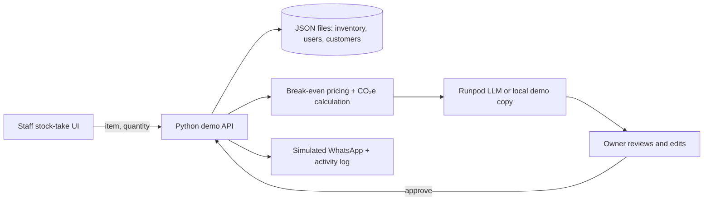

Smart Yield · Orbyte Eco-Salvage

A small, runnable hackathon demo for Malaysian bakeries. Staff enter end-of-day surplus, Smart Yield looks up product costs and carbon factors, drafts a locally flavored offer, and waits for the owner to approve it. Approval simulates a WhatsApp broadcast and writes an activity event. No real message is sent.

## Run it

Requires Python 3.10 or newer; no packages need to be installed.

```bash
python server.py
```

Open [http://localhost:8000](http://localhost:8000). The Python server serves both the page and API. Demo inventory and customers are in `data/`; approval updates inventory and writes `data/activity.json`.

To use a Runpod OpenAI-compatible endpoint, set `RUNPOD_API_URL` to the endpoint base URL (the server appends `/v1/chat/completions`), and optionally set `RUNPOD_API_KEY` and `RUNPOD_MODEL`. Without it, the API returns a built-in Manglish demo message. Keep credentials in environment variables; never commit them.

## Demo journey

1. Enter the remaining items and quantities on the 7 PM stock-take screen.
2. `POST /api/draft` checks the items against inventory, applies a break-even-aware offer price, estimates recovered gross margin and avoided CO₂e, and drafts copy.
3. The owner can edit the message, then approve or reject it. Approval requires a pending campaign and simulates delivery to the opted-in contact list.
4. `POST /api/approve` deducts the approved quantities and adds an activity record.

### Architecture



## API

| Method | Route | Purpose |
|---|---|---|
| `GET` | `/api/inventory` | Product pricing, stock, and carbon factors |
| `GET` | `/api/users` | Demo owner/staff roles and permissions |
| `GET` | `/api/customers` | Opted-in demo WhatsApp audience |
| `GET` | `/api/activity` | Recent campaign outcomes |
| `POST` | `/api/draft` | Validate stock and prepare an approval draft |
| `POST` | `/api/approve` | Approve a pending draft, simulate broadcast, update inventory/log |

Draft request example:

```json
{"items":[{"item":"croissant","qty":10},{"item":"chocolate_slice","qty":2}]}
```

Quantities must be positive whole numbers and cannot exceed on-hand inventory. Unknown products, duplicate product rows, malformed input, and negative quantities receive a `400` response. Price recommendations are at least cost and are set to half of retail, rounded to a whole RM when that remains above cost. Recovered value means gross margin above product cost; revenue and cost are included in the draft item breakdown.

## Demo data and access model

- `data/inventory.json`: retail and cost prices, weights, CO₂e factor, and stock.
- `data/users.json`: owner and staff role permissions for the RBAC demo.
- `data/customers.json`: fictional opted-in contacts; numbers are reserved-looking demo values, not a real customer list.
- `data/activity.json`: created after the first approval.

The role list is illustrative. This demo does not authenticate users or enforce RBAC. A production version should use authenticated sessions, secure webhooks/provider delivery, explicit customer consent records, locking for inventory changes, and a real persistent database.
